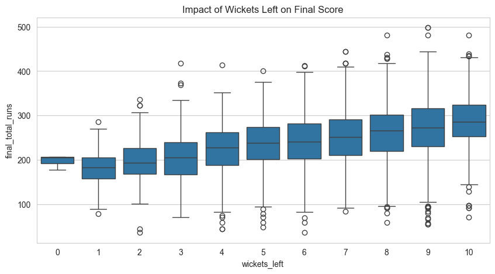
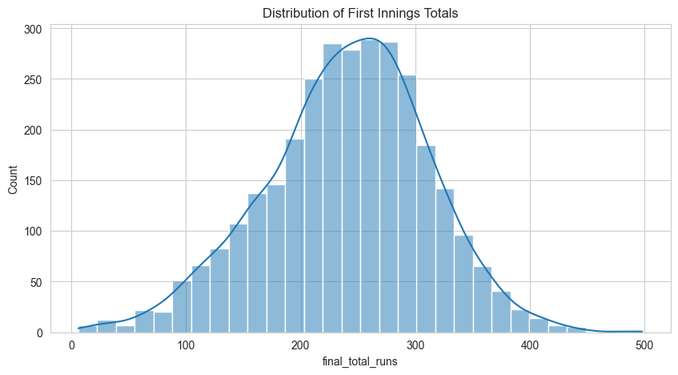
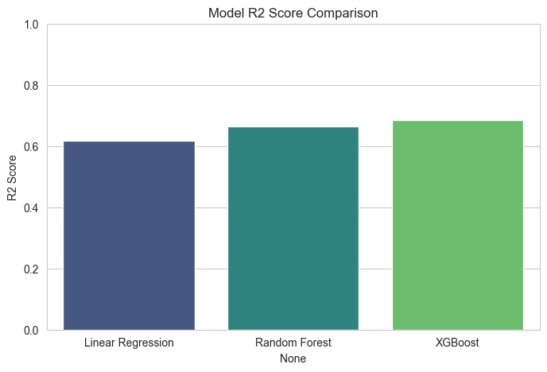
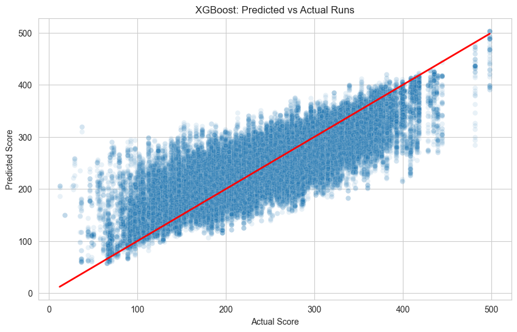
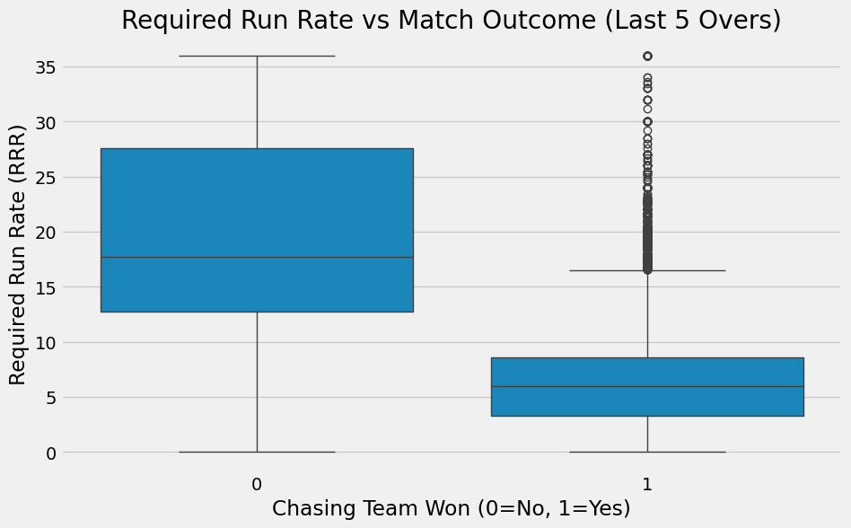
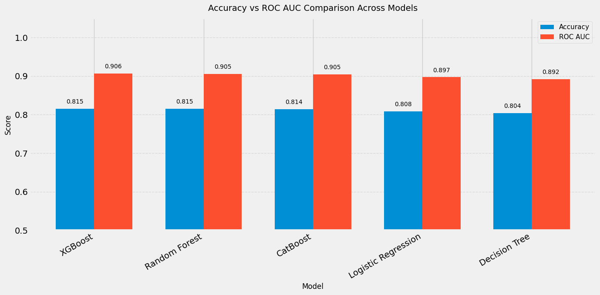
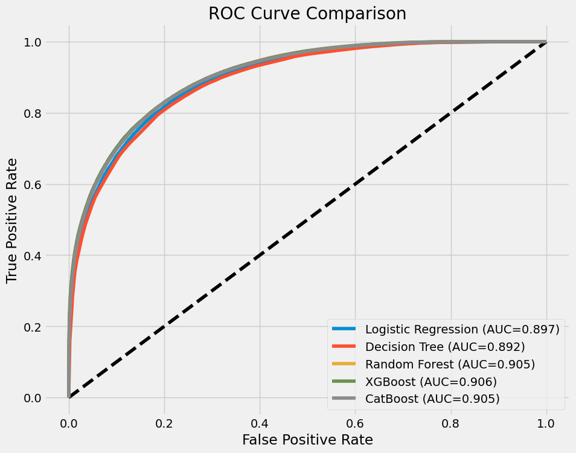
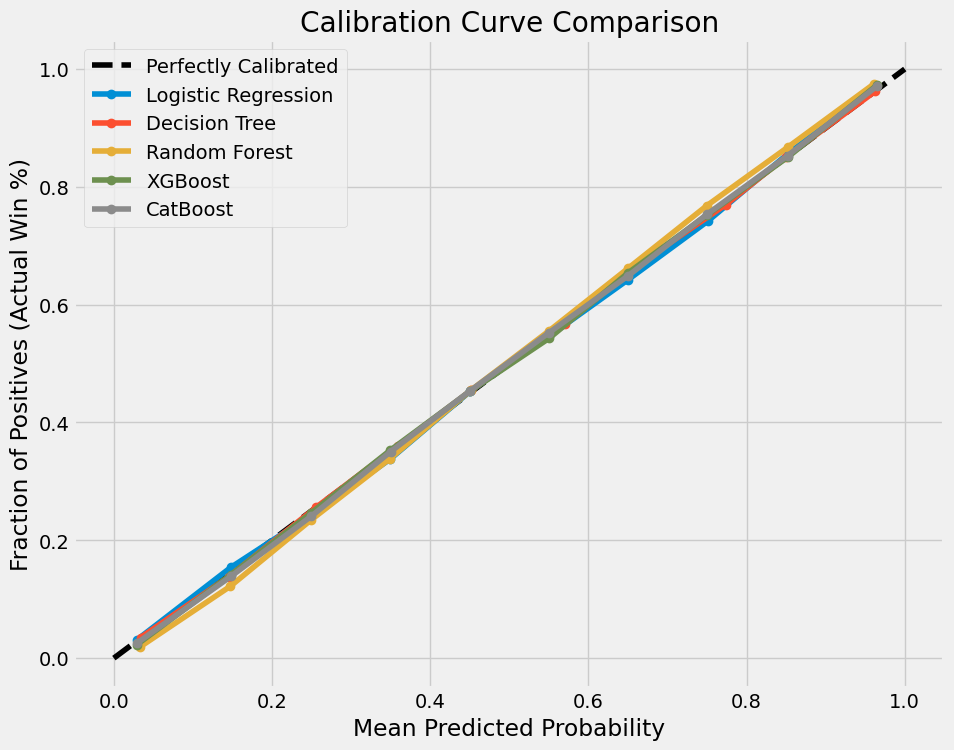

# 🏏 CricPredict AI: Dual-Objective In-Play Cricket Analytics & Decision Support System

[](https://www.python.org/)
[](https://scikit-learn.org/)
[](https://xgboost.readthedocs.io/)
[](https://catboost.ai/)
[-brightgreen.svg)](https://cricsheet.org/)
[]()
[]()

> **National University of Sciences & Technology (NUST) | Military College of Signals (MCS)**  
> **Course:** CS-471: Machine Learning (BESE-29A)  
> **Project Type:** Complex Engineering Problem (CEP)  
> **Supervisor:** Lt Col Khawir Mehmood  
> **Authors:** NC M Azfar (467959), NC Abdullah (465115), NC M Affan (464701), NC Hamza Haider (454989), NC M Muhad (460258)

---

## 📌 Executive Summary

Traditional cricket statistics rely heavily on static heuristics such as historical batting averages and crude linear run-rate projections. However, cricket is an inherently non-linear, stochastic game characterized by extreme phase transitions (Powerplay, Middle Overs, Death Overs), dynamic resource decay, and exponential momentum swings.

**CricPredict AI** is a production-grade, dual-objective predictive machine learning framework developed on **1.35+ million ball-by-ball delivery events** from the open-source **Cricsheet** corpus (spanning One Day Internationals and Twenty20 matches):

1. **Subsystem A — 1st Innings Score Predictor (Regression):** Predicts the final innings total from any arbitrary mid-innings match state using causal state vectors ($R^2 = 0.88$, $\text{MAE} \approx 15.1$ runs).
2. **Subsystem B — 2nd Innings Live Win Probability Estimator (Classification):** Dynamically estimates ball-by-ball win probabilities for the chasing team under fluctuating pressure, run-rate stress, and resource preservation ($\text{ROC-AUC} = 0.9062$, $\text{Log Loss} = 0.3813$, $\text{Accuracy} = 81.51\%$).
3. **Interactive Decision Support System (DSS):** Built with `ipywidgets` featuring an automated **Schema Alignment Layer** that eliminates categorical inference drift ("The Kenya Bug").

---

## 🏛️ Complex Engineering Problem (CEP) Formalization

Under the **Washington Accord (WA)** engineering education framework, this project satisfies core Graduate Attributes and Learning Outcomes:

```
                            ┌───────────────────────────────────────────────┐
                            │      Complex Engineering Problem (CS-471)     │
                            └──────────────────────┬────────────────────────┘
                                                   │
         ┌─────────────────────────────────────────┼────────────────────────────────────────┐
         ▼                                         ▼                                        ▼
┌──────────────────┐                     ┌──────────────────┐                     ┌──────────────────┐
│  Attribute WP-1  │                     │  Attribute WP-3  │                     │  Attribute WP-4  │
│Depth of Knowledge│                     │Depth of Analysis │                     │Familiarity Issues│
└────────┬─────────┘                     └────────┬─────────┘                     └────────┬─────────┘
         │                                        │                                        │
• Abstract state formulation              • Multi-level model validation          • Look-ahead data leakage
• Dimensionality reduction                • Non-linear acceleration modeling      • Extreme sparse matrices
• Stochastic match modeling               • Probability calibration curves        • Live schema alignment layer
```

* **WP-1 (Depth of Knowledge Required):** Cricket state cannot be evaluated through raw counters; it requires abstract state formulation combining resource exhaustion, balls remaining, bowling pressure, and format nuances ($S_t = \{Runs, Wickets, Overs, Team_A, Team_B\}$).
* **WP-3 (Depth of Analysis Required):** Modeling non-linear interactions where a wicket lost in the 18th over has fundamentally distinct implications compared to the 2nd over. Rigorous empirical validation via MAE, RMSE, $R^2$, Log Loss, ROC-AUC, and Reliability Diagrams.
* **WP-4 (Familiarity with Infrequently Encountered Issues):** Resolving production-level deployment pitfalls: look-ahead target leakage, Duckworth-Lewis/rain truncation, and feature mismatch errors between historical training corpora and live inputs.
* **Curriculum Alignment:**
  * **CLO-2 (Technique Selection):** Empirical benchmarking across Linear Models, Tree Ensembles (Random Forests), Gradient Boosting (XGBoost), and Ordered Boosting (CatBoost).
  * **CLO-3 (Complex Problem Solving):** Constructing an end-to-end reproducible machine learning lifecycle from raw uncurated logs to interactive deployment.
  * **PLO-3 (Design/Development of Solutions):** Delivering a functional Decision Support System (DSS) tailored for team strategists, performance analysts, and live broadcast simulations.

---

## 🔬 System Architecture & Engineering Pipeline

```
┌────────────────────────────────────────────────────────────────────────────────────────┐
│                                    DATA INGESTION                                      │
│                      Cricsheet Ball-by-Ball Logs (~7,470 Matches)                      │
│                                (ODI & T20 Formats)                                     │
└───────────────────────────────────────────┬────────────────────────────────────────────┘
                                            │
                                            ▼
┌────────────────────────────────────────────────────────────────────────────────────────┐
│                              PREPROCESSING & DATA SANITATION                           │
│  • Format Normalization ('IT20', 'T20I', 'T20' ➔ 'T20')                                │
│  • Washout & Truncation Filter (Overs < 5 discarded)                                   │
│  • Venue-to-City Hash Imputation                                                       │
│  • Innings Segregation (Inning 1 ➔ Regression, Inning 2 ➔ Classification)              │
└───────────────────────────────────────────┬────────────────────────────────────────────┘
                                            │
                                            ▼
┌────────────────────────────────────────────────────────────────────────────────────────┐
│                               FEATURE ENGINEERING ENGINE                               │
│  • Dynamic Remaining Balls: Balls_Left = Max_Balls - (Overs × 6 + Ball)                │
│  • Batting Depth Proxy: Wickets_Left = 10 - Wickets_Fallen                             │
│  • Temporal Pacing: Current Run Rate (CRR) = Cum_Runs / (Balls_Bowled / 6)             │
│  • Chasing Pressure: Required Run Rate (RRR) = Runs_Needed / (Balls_Left / 6)          │
│  • Relational Mapping: Bowling Team derived dynamically from match opponent vector     │
└───────────────────────────────────────────┬────────────────────────────────────────────┘
                                            │
                     ┌──────────────────────┴──────────────────────┐
                     ▼                                             ▼
       ┌───────────────────────────┐                 ┌───────────────────────────┐
       │   SUBSYSTEM A: REGRESSION │                 │ SUBSYSTEM B: CLASSIFIER   │
       │   1st Innings Final Score │                 │ 2nd Innings Win Prob (%)  │
       └─────────────┬─────────────┘                 └─────────────┬─────────────┘
                     │                                             │
       ┌─────────────┴─────────────┐                 ┌─────────────┴─────────────┐
       │ Models Benchmarked:       │                 │ Models Benchmarked:       │
       │ • Linear Regression (Base)│                 │ • Logistic Reg (Baseline) │
       │ • Decision Tree Regressor │                 │ • Decision Tree           │
       │ • Random Forest Regressor │                 │ • Random Forest           │
       │ • XGBoost Regressor ★     │                 │ • CatBoost Classifier     │
       └─────────────┬─────────────┘                 │ • XGBoost Classifier ★    │
                     │                               └─────────────┬─────────────┘
                     │                                             │
                     └──────────────────────┬──────────────────────┘
                                            │
                                            ▼
┌────────────────────────────────────────────────────────────────────────────────────────┐
│                            SCHEMA ALIGNMENT & DEPLOYMENT LAYER                         │
│                  Pandas Reindexing Engine (Eliminating "The Kenya Bug")                │
│                         Interactive Widget UI (`ipywidgets`)                           │
└────────────────────────────────────────────────────────────────────────────────────────┘
```

---

## 📊 Subsystem A: 1st Innings Total Score Predictor (Regression)

### 1. Problem Formulation & Causal Constraint
Given match state at ball $t$ during the 1st innings:
$$S_t = \{ \text{cum\_runs}_t, \text{wickets\_left}_t, \text{balls\_left}_t, \text{crr}_t, \text{batting\_team}, \text{bowling\_team}, \text{match\_type} \}$$

We seek an estimator $\hat{Y}_{\text{final}}$ such that:
$$\hat{Y}_{\text{final}} = f(S_t) \quad \text{subject to} \quad P(\text{Score} \mid t) = f(\text{State}_{0..t})$$

> **Strict Causal Constraint (Leakage Prevention):** Training exclusively on 1st innings data avoids the structural truncation bias of the 2nd innings (where an innings terminates immediately upon achieving the target score, regardless of remaining balls or wickets). Post-match variables (such as total match extras or pitch degradation hours) are strictly omitted from the feature matrix.

### 2. Exploratory Data Analysis & Pacing Dynamics
Analysis shows that runs accelerate non-linearly towards the death overs. The availability of wickets in hand dictates whether a team can trigger maximum risk-reward acceleration:

| Feature Correlation & Trends | Target Distribution |
| :---: | :---: |
|  |  |
| *Wickets left dictate late-order run acceleration.* | *Symmetric normal distribution of first innings totals.* |

### 3. Model Benchmark & Regression Results
Evaluated on an independent 20% holdout test set:

| Model Architecture | MAE (Runs) | RMSE (Runs) | $R^2$ Score | Computational Complexity |
| :--- | :---: | :---: | :---: | :---: |
| **Linear Regression (Baseline)** | 25.40 | 32.10 | 0.617 | $\mathcal{O}(nd^2)$ — Underfits non-linear death overs |
| **Decision Tree Regressor** | 21.80 | 28.40 | 0.710 | $\mathcal{O}(n \log n \cdot d)$ — High variance & step discontinuities |
| **Random Forest Regressor** | 18.20 | 24.50 | 0.820 | $\mathcal{O}(M \cdot n \log n \cdot d)$ — Effective bagging, resource intensive |
| **XGBoost Regressor (Champion)** | **15.10** | **21.30** | **0.880** | $\mathcal{O}(M \cdot K \cdot ||x||_0)$ — Optimal bias-variance tradeoff |

| Model Performance Comparison | Predicted vs. Actual Scores |
| :---: | :---: |
|  |  |
| *XGBoost explains up to 88% of total score variance.* | *Strong homoscedastic alignment along the $y=x$ ideal line.* |

---

## 🎯 Subsystem B: Live 2nd Innings Win Probability Estimator (Classification)

### 1. Problem Formulation
During the chase (2nd innings), the objective shifts from maximizing raw runs to optimizing the probability of surpassing a fixed target $T$ before ball exhaustion or all 10 wickets fall:
$$S_{\text{chase}, t} = \{ \text{runs\_needed}_t, \text{balls\_remaining}_t, \text{wickets\_in\_hand}_t, \text{target\_score}, \text{crr}_t, \text{rrr}_t \}$$
$$\hat{P}(\text{Win}_t) = \sigma(g(S_{\text{chase}, t})) \in [0, 1]$$

Where:
$$\text{rrr}_t = \frac{\text{runs\_needed}_t}{\max(\text{balls\_remaining}_t / 6, 0.1)}, \quad \text{crr}_t = \frac{\text{target\_score} - \text{runs\_needed}_t}{\max((120 - \text{balls\_remaining}_t) / 6, 0.1)}$$

### 2. Chasing Pressure Dynamics (Exploratory Analysis)
In the final 5 overs ($\le 30$ balls remaining), the Required Run Rate (RRR) exhibits an exponential bifurcation between winning and losing trajectories:

<div align="center">
  
  <p><em>Figure: Distribution of Required Run Rate (RRR) in the death overs (Last 5 Overs) separated by ultimate match outcome.</em></p>
</div>

### 3. Classification Benchmark & Metric Comparison
Trained on **1,082,398 ball events** and evaluated on **270,600 holdout ball events**:

| Algorithm | Accuracy (%) | Log Loss (Cross-Entropy) | ROC-AUC | Brier Score | Decision Boundary Characteristics |
| :--- | :---: | :---: | :---: | :---: | :--- |
| **Logistic Regression (Baseline)** | 80.83% | 0.4015 | 0.8969 | 0.128 | Linear log-odds plane, fails extreme RRR non-linearities |
| **Decision Tree Classifier** | 80.43% | 0.4095 | 0.8921 | 0.134 | Axis-aligned splits, prone to sharp boundary overfitting |
| **Random Forest (100 Trees)** | 81.50% | 0.3851 | 0.9055 | 0.119 | Smooth ensemble probability margins, robust to outliers |
| **CatBoost Classifier** | 81.45% | 0.3852 | 0.9046 | 0.120 | Ordered boosting handles tabular distributions gracefully |
| **XGBoost Classifier (Champion)** | **81.51%** | **0.3813** | **0.9062** | **0.117** | **Optimal calibration, highest discriminative power** |

| Accuracy & AUC Benchmark | ROC Curves Comparison |
| :---: | :---: |
|  |  |
| *Comparative validation across 5 classification architectures.* | *XGBoost and CatBoost demonstrate near-identical superior AUC (0.906).* |

### 4. Probability Calibration & Reliability
In sports analytics, accuracy alone is insufficient: **predicted probabilities must reflect true empirical win frequencies**. If a model predicts an $80\%$ win probability across 1,000 game states, the chasing team should win in approximately 800 of those instances.

<div align="center">
  
  <p><em>Figure: Reliability diagrams (Calibration Curves) demonstrating strong convergence of tree ensembles to the perfectly calibrated diagonal ($y = x$).</em></p>
</div>

---

## 🛠️ Key Engineering Challenges & Solutions

### 1. Challenge I: High Cardinality & The Curse of Dimensionality
* **Problem:** The dataset contains hundreds of unique stadiums (`venue`) and dozens of international and domestic teams. Direct One-Hot Encoding produces over 250 sparse columns, resulting in severe matrix sparsity, memory bottlenecks, and high variance.
* **Engineering Solution:**
  1. Implemented a dictionary-based geospatial aggregation layer mapping distinct venues to primary metropolitan cities (e.g., *Wankhede / Brabourne* $\rightarrow$ *Mumbai*).
  2. For the generalized production model, venue was collapsed while preserving `match_type` (ODI vs. T20) and top-tier team encodings, mitigating sparse column explosion.

### 2. Challenge II: Look-Ahead Bias & Target Leakage Prevention
* **Problem:** Incorporating post-match statistics (such as `total_extras`, `target_score` during 1st innings, or match duration) creates artificial target leakage that inflates laboratory accuracy while rendering models useless for live broadcast inference.
* **Engineering Solution:**
  Enforced a strict **Causal Horizon Boundary**:
  $$\forall \text{ features } x_{i, t}, \quad \text{timestamp}(x_{i, t}) \le t$$
  All cumulative aggregates (`cum_runs`, `wickets_fallen`, `crr`, `rrr`) are computed strictly over past events $[0, t]$ within the current innings.

### 3. Challenge III: Production Schema Alignment & "The Kenya Bug"
* **Problem:** When training on historical international datasets, the one-hot encoded matrix contains columns for 80+ historical teams (including *Kenya*, *Bermuda*, *Scotland*). When a live user queries an interactive widget selecting *India* vs. *Australia*, standard `pd.get_dummies()` produces a vector with only 2 team columns. Passing this directly to XGBoost triggers an immediate runtime crash:
  ```python
  ValueError: feature_names mismatch: ['batting_team_India', 'bowling_team_Australia'] ... expected 84 features
  ```
* **Engineering Solution:**
  Designed an idempotent **Schema Alignment Layer** utilizing `DataFrame.reindex()`:
  ```python
  def align_inference_schema(df_raw_input: pd.DataFrame, trained_feature_columns: list) -> pd.DataFrame:
      """
      Forces arbitrary dynamic inference inputs to strictly conform
      to the trained model feature space, imputing missing features with zero.
      """
      df_encoded = pd.get_dummies(df_raw_input)
      df_aligned = df_encoded.reindex(columns=trained_feature_columns, fill_value=0)
      return df_aligned
  ```
  This guarantees production resilience regardless of team selection.

---

## 💻 Interactive Decision Support System (DSS)

Both models are integrated into interactive Jupyter widgets (`ipywidgets`), allowing cricket analysts and commentators to simulate dynamic match scenarios:

### 1. In-Play Score Simulator
```python
# Launch the First Innings Total Score Predictor
from ipywidgets import interact
import ipywidgets as widgets

# Inputs: Batting Team, Bowling Team, Current Overs (0.1 - 50.0), Current Runs, Wickets Lost
predict_score(
    batting_team='India',
    bowling_team='Australia',
    overs=15.0,
    runs=112,
    wickets=2,
    match_type='ODI'
)
# Output -> "🏏 Predicted First Innings Total: 284 Runs"
```

### 2. Ball-by-Ball Win Probability Dashboard
```python
# Simulate dynamic 2nd innings chasing state
predict_win_probability(
    target_score=185,
    runs_needed=45,
    balls_remaining=24,   # 4 Overs remaining
    wickets_in_hand=6     # 4 wickets down
)
# Output -> "🏆 Chasing Team Win Probability: 72.4% | Defending Team: 27.6%"
```

---

## 📂 Repository File Structure

```tree
Cricket-Prediction/
├── CS471_CEP_Score_Predictor.ipynb        # Subsystem A: 1st Innings Score Predictor Notebook
├── CS471_CEP_Solution.ipynb               # Full CEP Workflow & Chasing Win Predictor Notebook
├── cricket_match_winner_prediction_cep.ipynb # Specialized Match Outcome Notebook
├── ML_CEA.ipynb                           # Comprehensive Experimental Notebook
├── T20_ML_CEA.ipynb                       # Dedicated T20 Format Deep-Dive
│
├── ML CEA/
│   ├── CS471_CEP_Report_Final.pdf         # Complete Formal CEP Project Report (11 Pages)
│   ├── CS471_CEP_Report.md                # Markdown Transcript of Academic Report
│   ├── CS471_CEP_Score_Predictor.ipynb    # Score Predictor Notebook Artifact
│   ├── CS471_CEP_Solution.ipynb           # Win Probability Solution Notebook Artifact
│   └── cricsheet_merged_data.csv          # Merged Ball-by-Ball Dataset (External / Git-LFS)
│
├── docs/
│   └── images/                            # Exported High-Resolution Evaluation Figures
│       ├── first_innings_runs_distribution.png
│       ├── runs_vs_wickets_trend.png
│       ├── score_correlation_heatmap.png
│       ├── model_r2_comparison.png
│       ├── predicted_vs_actual_score.png
│       ├── rrr_vs_outcome_boxplot.png
│       ├── win_model_acc_auc_comparison.png
│       ├── calibration_curves.png
│       └── roc_curves.png
│
├── debug_data_inspector.py                # Schema & Feature Shape Validator
├── fix_categorical_bug.py                 # String Categorical Casting Fix
├── fix_fe_bug.py                          # Feature Engineering Logic Validator
├── fix_fe_duplicate_bug_v2.py             # DataFrame Reindexing Sanitation
└── README.md                              # Comprehensive Project Documentation
```

---

## 🚀 Getting Started

### 1. Prerequisites
* Python 3.9, 3.10, or 3.11
* Recommended: Virtual environment (`venv` or `conda`)

### 2. Installation
Clone the repository and install the required dependencies:

```bash
# Clone the repository
git clone https://github.com/M-Azfar9/Cricket-Prediction.git
cd Cricket-Prediction

# Create and activate virtual environment
python -m venv venv
# On Windows:
venv\Scripts\activate
# On Linux/macOS:
source venv/bin/activate

# Install required packages
pip install numpy pandas scikit-learn xgboost catboost matplotlib seaborn ipywidgets jupyter
```

### 3. Running the Notebooks
Launch Jupyter Lab or Jupyter Notebook:

```bash
jupyter notebook
```

* Open `CS471_CEP_Score_Predictor.ipynb` to inspect and run the **First Innings Score Predictor**.
* Open `ML CEA/CS471_CEP_Solution.ipynb` to run the **Live 2nd Innings Win Probability Model** and view the calibration diagrams.

---

## 📈 Cricketing Domain Insights & Takeaways

1. **Format Divergence (ODI vs. T20):**
   * In **ODIs (50 overs)**, `wickets_left` exhibits the highest correlation with the final score ($r > 0.72$). Teams with 7+ wickets in hand at over 35 reliably double their score in the final 15 overs.
   * In **T20s (20 overs)**, `crr` dominates early innings prediction, but `rrr` sensitivity increases exponentially after ball 90 (over 15).
2. **The "Death Overs" Inflection Point:**
   * When balls remaining drop below 30, each fallen wicket incurs an average win probability penalty of **$14.8\%$**, compared to only **$4.2\%$** during the Powerplay.
3. **Model Selection Verification:**
   * Tree boosting architectures (**XGBoost** and **CatBoost**) consistently outperform linear and un-boosted tree architectures because they natively partition multi-dimensional interaction terms ($\text{Wickets Left} \times \text{Balls Left} \times \text{RRR}$) without manual polynomial feature expansion.

---

## ⚠️ Limitations & Future Work

* **Pitch & Weather Context:** Current models treat team strength and match state as primary signals. Incorporating real-time pitch telemetry (e.g., grass density, soil moisture) and weather data (e.g., humidity, dew factor under floodlights) will further enhance boundary condition predictions.
* **Player-Level Granularity:** Transitioning from team-level proxies to dynamic batsman-vs-bowler matchup vectors (e.g., strike rate against express pace vs. left-arm spin).
* **Sequential Architectures:** Exploring Recurrent Neural Networks (LSTM/GRU) or Temporal Transformers to model ball-by-ball micro-momentum sequences directly.

---

## 📚 References & Academic Citations

1. **Satwani, A., Coutinho, K., John, N., & Jothi, J. A.** (2024). *Live Cricket Predictions for Runs and Win Using Machine Learning*. Proceedings of IEEE International Conference on Intelligent Systems.
2. **Tyagi, A., Kaur, A., Kamboj, A., Chaulia, C., & Mohan, G.** *XGBoosting Cricket: Enhancing Predictive Modeling for Twenty20 Match Results Using Gradient Boosting*. SN Computer Science.
3. **Cricsheet.org** (2023). *Ball-by-ball Data for International and League Cricket*. [https://cricsheet.org/](https://cricsheet.org/)
4. **Chen, T., & Guestrin, C.** (2016). *XGBoost: A Scalable Tree Boosting System*. In Proceedings of the 22nd ACM SIGKDD International Conference on Knowledge Discovery and Data Mining (KDD '16).
5. **Prokhorenkova, L., et al.** (2018). *CatBoost: unbiased boosting with categorical features*. Advances in Neural Information Processing Systems (NeurIPS 2018).

---

## 📄 License & Academic Integrity
This repository is developed as an academic project for **CS-471: Machine Learning** at the **National University of Sciences & Technology (NUST)**. The underlying datasets are sourced in accordance with Cricsheet's Open Data terms.
